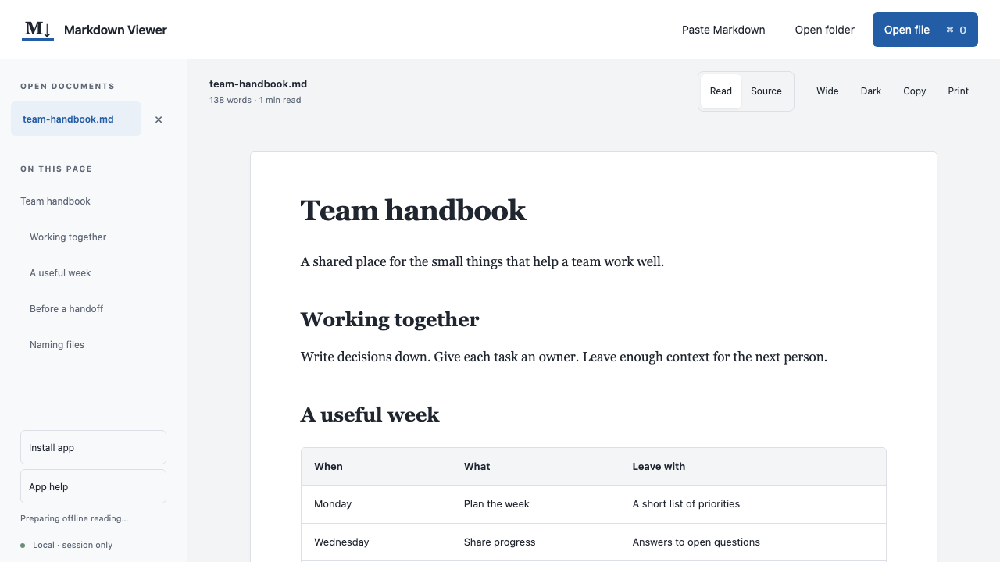
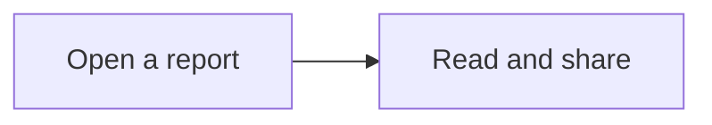

# Markdown Viewer

A small reader for the Markdown file someone just sent you. Open reports, notes, and READMEs with local images and Mermaid diagrams. Read in your browser or install the app for offline use.

**[Open Markdown Viewer](https://nino-markdown-viewer.pages.dev/)** · [Download the offline HTML](https://github.com/nino-chavez/markdown-viewer/releases/latest/download/Markdown.Viewer.html) · [All releases](https://github.com/nino-chavez/markdown-viewer/releases)

1. Open the website in Chrome, or download **Markdown.Viewer.html** and open it.
2. Choose **Open file**, drop a Markdown file into the window, or choose **Paste Markdown**.
3. Read your document. Bookmark the website or install it using the steps below.

No account. Installation is optional. Your documents stay on your device, and the originals stay unchanged. Tested in Chrome on macOS.



*Actual viewer with a [generic sample handbook](examples/team-handbook.md).*

## Install on Mac

1. Open [Markdown Viewer](https://nino-markdown-viewer.pages.dev/) in **Google Chrome**.
2. Choose **Install app** in the sidebar and confirm Chrome's installation prompt.
3. Wait for **Ready for offline reading** before disconnecting. The installed app can then open without an internet connection.
4. In Finder, right-click a `.md` file and choose **Open With → Markdown Viewer**. Approve Chrome's file-opening prompt when shown.

If the install prompt is unavailable, use Chrome's **Cast, save, and share → Install page as app** menu. **App help** repeats these instructions inside the viewer.

To make it the default for `.md` files, choose **Get Info → Open with → Markdown Viewer → Change All** in Finder. This is optional. The app also registers `.markdown`, `.mdown`, and `.mkd`; assign those separately if needed. It does not take over `.txt` files.

Finder can open files into an existing app window. Opening a file does not grant access to neighboring images; select them with **Open folder** or **Add images**.

An update waits until all viewer windows close. It never reloads an open reading session automatically. Clearing the website's stored data removes its offline copy; reopen online to restore it.

## When it fits

Use it for occasional Markdown reading when you want a formatted view without setting up an editor. Keep one HTML file, drop in a document, and use the outline, tables, or print controls. You can share the viewer with a coworker without asking them to install an editor.

If you already have a Markdown workflow that works, there is little reason to switch:

| Your usual job | An existing option |
| --- | --- |
| Write Markdown in a browser, with preview and optional sync | [StackEdit](https://stackedit.io/) |
| Read and edit in a dedicated Markdown app | [Typora](https://typora.io/) |
| Keep and connect a collection of notes | [Obsidian](https://obsidian.md/) |
| Edit plain text and code | [Sublime Text](https://www.sublimetext.com/) |

Offline use is also available in other tools. This viewer offers a reading-only interface, an installable website, and a single HTML file as a portable backup.

For a one-time handoff where the recipient only needs to read, a PDF or an already-rendered HTML document may be easier. This viewer is useful when Markdown files keep arriving from different sources.

## Reading

| You want to… | Use… |
| --- | --- |
| Jump to a section | The outline on the left |
| Compare several documents | Open more files, then switch in the sidebar |
| See the original Markdown | **Source**; choose **Read** to return |
| Give a wide table more room | **Wide**, then scroll inside the table |
| Read on a dark background | **Dark** |
| Copy the Markdown | **Copy** |
| Print or save a PDF | **Print**, then your browser’s PDF option |

**Command+O** on Mac or **Ctrl+O** opens the file picker. After editing a document elsewhere, open it again to refresh.

Open documents last for the current session. Reloading or closing the viewer clears them. Opening a file with the same name replaces its session copy.

## Images and diagrams

**Local images:** choose **Open folder** and select the folder containing the Markdown and its images. The viewer opens its Markdown files and resolves image paths within that folder. Keep subfolders together.

If you opened a Markdown file by itself, use **Add images** in the missing-image notice. Choose the referenced PNG, JPEG, WebP, or GIF files. **Choose document folder** attaches images from a folder without opening its other documents. The browser only grants access to files you select.

Embedded base64 raster images also work. Remote images and SVG files stay blocked.

**Mermaid:** fenced `mermaid` blocks render automatically, without an internet connection:

````markdown

````

Flowcharts, sequence diagrams, entity-relationship diagrams, mindmaps, and architecture diagrams have been checked. Expand **Diagram source** to inspect the original definition. Invalid or unsupported diagrams show their source instead. Diagram settings, HTML labels, image/icon nodes, external resources, and click actions are unsupported.

**Print** waits for images and diagrams, then uses light diagrams for paper or PDF.

Try the [media example](examples/media-guide.md) from the **Source code (zip)** on the [release page](https://github.com/nino-chavez/markdown-viewer/releases/latest): unzip it, choose **Open folder**, and select the extracted folder. Open `examples/media-guide.md` in the sidebar.

<details>
<summary>Media limits</summary>

- Images: first 20 references; up to 8 MB and 16 million pixels each; 32 million pixels combined per document.
- Diagrams: first 10 blocks; up to 8,000 characters, 200 lines, and 200 edges each.
- Session: up to 30 documents and 64 MB of selected image files. A folder selection may contain up to 1,000 files.

Larger or unsupported media show a message. The original Markdown stays available in **Source**.

</details>

## Files and privacy

Accepts `.md`, `.markdown`, `.mdown`, `.mkd`, `.txt`, and extensionless `README` files, up to 2 MB each. You can also paste Markdown.

The website downloads its application code and icons, then saves those public files for offline use. It does not upload documents or retain document contents, images, or file handles in browser storage. Only theme and width preferences persist. There are no accounts or application analytics.

The standalone HTML contains everything it needs and makes no automatic network requests. In both versions, web links open only when clicked; local file links stay inactive.

This is a reader: it does not edit or watch files. Theme and width preferences may persist when the browser allows local storage.

Checked in desktop Chrome on macOS, including a phone-sized viewport. Safari, Windows, and physical phones have not been verified. Very wide tables may need landscape orientation when printing.

## Sharing

Send coworkers the **[website](https://nino-markdown-viewer.pages.dev/)**, the [download link](https://github.com/nino-chavez/markdown-viewer/releases/latest/download/Markdown.Viewer.html), or a copy of the HTML file. They do not need the source code or a GitHub account.

If the file opens as text, use **Open With → Google Chrome**. Keep its `.html` extension. To update, download the latest release and replace your old viewer file.

## Development

Only needed if you want to change the viewer. Use Node.js 26, the version used for these checks.

```sh
npm ci
npm run build
```

The build produces `dist/Markdown Viewer.html` and the installable website in `dist/site/`. Both include the reader, parser, sanitizer, and Mermaid. The HTML bundles its license notices; the website also publishes `THIRD_PARTY_NOTICES.txt`.

```sh
npm run check
npm test
npx playwright install chromium
npm run test:e2e
```

Browser tests build and open the packaged HTML in a temporary Chromium session. They cover file handling, source fidelity, drag feedback, local and embedded images, diagrams, printing, sanitization, network isolation, and automated accessibility.

The PWA tests serve `dist/site/` on loopback. They check a cold offline launch, the file-launch handler, cache contents, blocked uploads, install help, and update behavior. Set `VIEWER_BASE_URL` to check a deployed site; the test-only update trigger is skipped there. These tests do not replace checking Finder and the installed app on a Mac.

To test against an existing debugging browser, set `BROWSE_CDP_URL` to its endpoint. To check a downloaded release, set `VIEWER_HTML_PATH` to the downloaded HTML file.

```text
src/app.ts      — files and controls
src/render.ts   — render and sanitize
src/images.ts   — selected images and path resolution
src/diagrams.ts — offline Mermaid rendering
src/pwa.ts      — installation, offline status, and Finder launches
src/sw.js       — caches public app files only
src/style.css   — layout and themes
src/index.html  — page structure
public/         — manifest, icons, and hosting headers
build.mjs       — offline HTML and installable site
```

Deployment settings and verification are in [DEPLOY.md](DEPLOY.md).

## License

[MIT](LICENSE). You may use, modify, and share the viewer. Licenses for Marked, DOMPurify, Mermaid, and their bundled dependencies are included in [Third-party notices](THIRD_PARTY_NOTICES.txt) and in the downloaded HTML.
