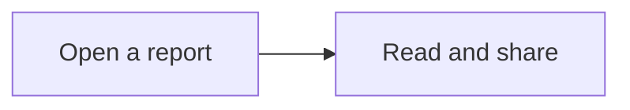

# Markdown Viewer

A small, offline reader for the Markdown file someone just sent you. Open reports, notes, and READMEs with local images and Mermaid diagrams in your browser.

**[Download Markdown Viewer](https://github.com/nino-chavez/markdown-viewer/releases/latest/download/Markdown.Viewer.html)** · [All releases](https://github.com/nino-chavez/markdown-viewer/releases)

1. Download **Markdown.Viewer.html** and open it in Chrome.
2. Choose **Open file**, drop a Markdown file into the window, or choose **Paste Markdown**.
3. Read your document. Keep the viewer wherever you like and open it again whenever you need it.

No installation, account, or server. Your documents stay on your device, and the originals stay unchanged. Tested in Chrome on macOS.


*Actual viewer with a [generic sample handbook](examples/team-handbook.md).*

## When it fits

Use it for occasional Markdown reading when you want a formatted view without setting up an editor. Keep one HTML file, drop in a document, and use the outline, tables, or print controls. You can share the viewer with a coworker without asking them to install an editor.

If you already have a Markdown workflow that works, there is little reason to switch:

| Your usual job | An existing option |
| --- | --- |
| Write Markdown in a browser, with preview and optional sync | [StackEdit](https://stackedit.io/) |
| Read and edit in a dedicated Markdown app | [Typora](https://typora.io/) |
| Keep and connect a collection of notes | [Obsidian](https://obsidian.md/) |
| Edit plain text and code | [Sublime Text](https://www.sublimetext.com/) |

Offline use is also available in other tools. This viewer’s particular convenience is its single, shareable HTML file and reading-only interface.

For a one-time handoff where the recipient only needs to read, a PDF or an already-rendered HTML document may be easier. This viewer is useful when Markdown files keep arriving from different sources.

## Reading

| You want to… | Use… |
| --- | --- |
| Jump to a section | The outline on the left |
| Compare several documents | Open more files, then switch in the sidebar |
| See the original Markdown | **Source**; choose **Read** to return |
| Give a wide table more room | **Wide**, then scroll inside the table |
| Read on a dark background | **Dark** |
| Copy the Markdown | **Copy** |
| Print or save a PDF | **Print**, then your browser’s PDF option |

**Command+O** on Mac or **Ctrl+O** opens the file picker. After editing a document elsewhere, open it again to refresh.

Open documents last for the current session. Reloading or closing the viewer clears them. Opening a file with the same name replaces its session copy.

## Images and diagrams

**Local images:** choose **Open folder** and select the folder containing the Markdown and its images. The viewer opens its Markdown files and resolves image paths within that folder. Keep subfolders together.

If you opened a Markdown file by itself, use **Add images** in the missing-image notice. Choose the referenced PNG, JPEG, WebP, or GIF files. **Choose document folder** attaches images from a folder without opening its other documents. The browser only grants access to files you select.

Embedded base64 raster images also work. Remote images and SVG files stay blocked.

**Mermaid:** fenced `mermaid` blocks render automatically, without an internet connection:

````markdown

````

Flowcharts, sequence diagrams, entity-relationship diagrams, mindmaps, and architecture diagrams have been checked. Expand **Diagram source** to inspect the original definition. Invalid or unsupported diagrams show their source instead. Diagram settings, HTML labels, image/icon nodes, external resources, and click actions are unsupported.

**Print** waits for images and diagrams, then uses light diagrams for paper or PDF.

Try the [media example](examples/media-guide.md) from the **Source code (zip)** on the [release page](https://github.com/nino-chavez/markdown-viewer/releases/latest): unzip it, choose **Open folder**, and select the extracted folder. Open `examples/media-guide.md` in the sidebar.

<details>
<summary>Media limits</summary>

- Images: first 20 references; up to 8 MB and 16 million pixels each; 32 million pixels combined per document.
- Diagrams: first 10 blocks; up to 8,000 characters, 200 lines, and 200 edges each.
- Session: up to 30 documents and 64 MB of selected image files. A folder selection may contain up to 1,000 files.

Larger or unsupported media show a message. The original Markdown stays available in **Source**.

</details>

## Files and privacy

Accepts `.md`, `.markdown`, `.mdown`, `.mkd`, `.txt`, and extensionless `README` files, up to 2 MB each. You can also paste Markdown.

The viewer contains everything it needs to render text, supported images, and diagrams. It makes no automatic network requests and does not upload documents. Web links open only when clicked; local file links stay inactive.

This is a reader: it does not edit or watch files. Theme and width preferences may persist when the browser allows local storage.

Checked in desktop Chrome on macOS, including a phone-sized viewport. Safari, Windows, and physical phones have not been verified. Very wide tables may need landscape orientation when printing.

## Sharing

Send coworkers the **[download link](https://github.com/nino-chavez/markdown-viewer/releases/latest/download/Markdown.Viewer.html)** or a copy of the HTML file. They do not need the source code or a GitHub account.

If the file opens as text, use **Open With → Google Chrome**. Keep its `.html` extension. To update, download the latest release and replace your old viewer file.

## Development

Only needed if you want to change the viewer. Use Node.js 26, the version used for these checks.

```sh
npm ci
npm run build
```

The output is `dist/Markdown Viewer.html`. The build includes the app, styles, parser, sanitizer, Mermaid, and license notices in that single file.

```sh
npm run check
npm test
npx playwright install chromium
npm run test:e2e
```

Browser tests build and open the packaged HTML in a temporary Chromium session. They cover file handling, source fidelity, drag feedback, local and embedded images, diagrams, printing, sanitization, network isolation, and automated accessibility.

To test against an existing debugging browser, set `BROWSE_CDP_URL` to its endpoint. To check a downloaded release, set `VIEWER_HTML_PATH` to the downloaded HTML file.

```text
src/app.ts      — files and controls
src/render.ts   — render and sanitize
src/images.ts   — selected images and path resolution
src/diagrams.ts — offline Mermaid rendering
src/style.css   — layout and themes
src/index.html  — page structure
build.mjs       — offline HTML bundle
```

## License

[MIT](LICENSE). You may use, modify, and share the viewer. Licenses for Marked, DOMPurify, Mermaid, and their bundled dependencies are included in [Third-party notices](THIRD_PARTY_NOTICES.txt) and in the downloaded HTML.
