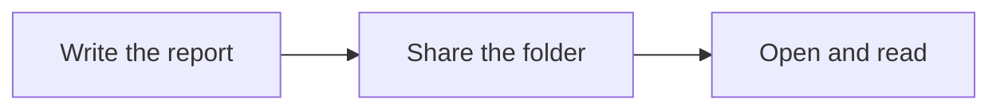
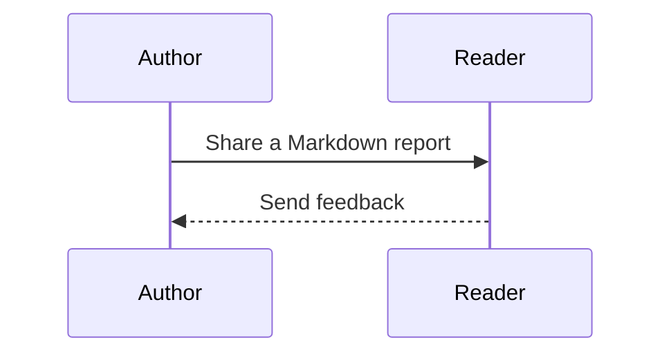
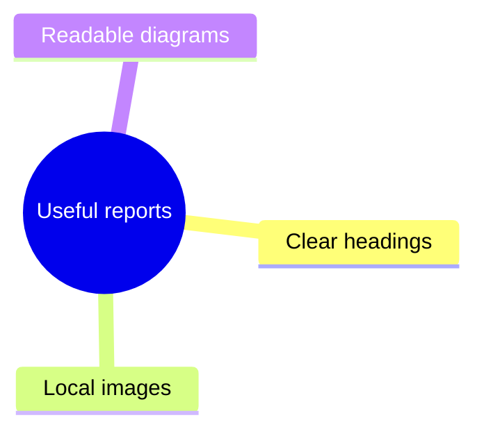

# A report with images and diagrams

Keep the document and its images together. Everything on this page can be read offline.

## A simple handoff

## A local image

This is a screenshot of the viewer displaying a generic team handbook.

## A conversation

## A few connected ideas

## Source and printing

Use **Source** to inspect the original Markdown. Expand **Diagram source** below a diagram to read its definition. **Print** waits for media to finish loading and uses light diagrams for paper.
